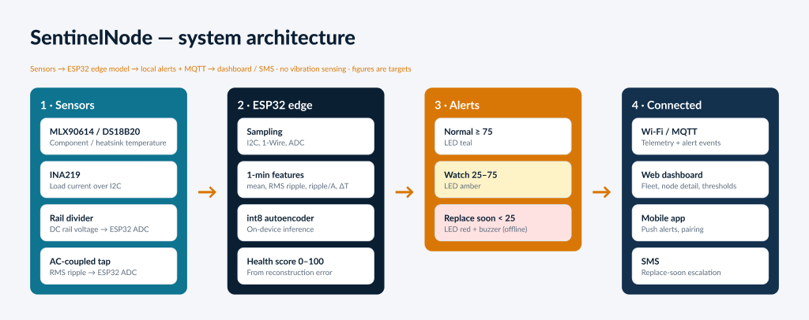
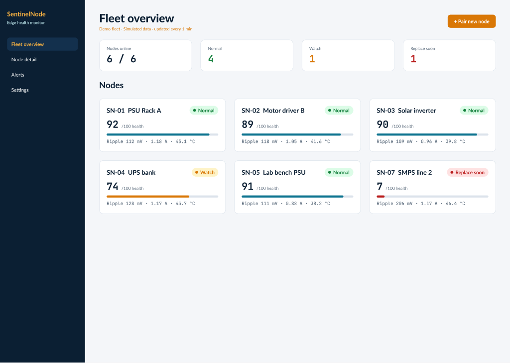
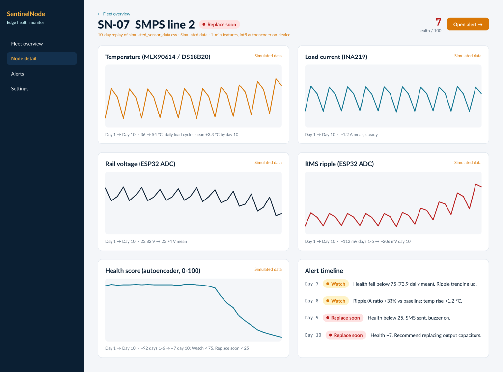
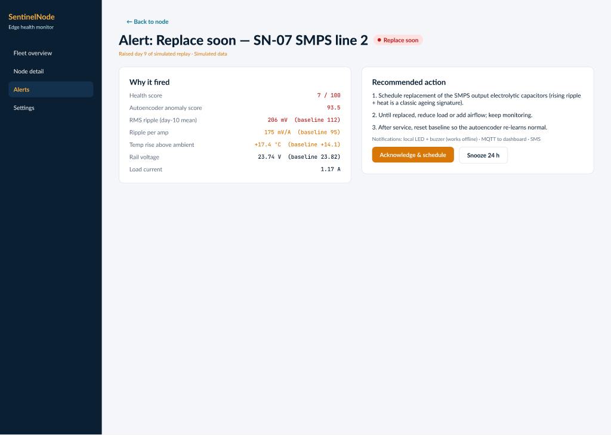
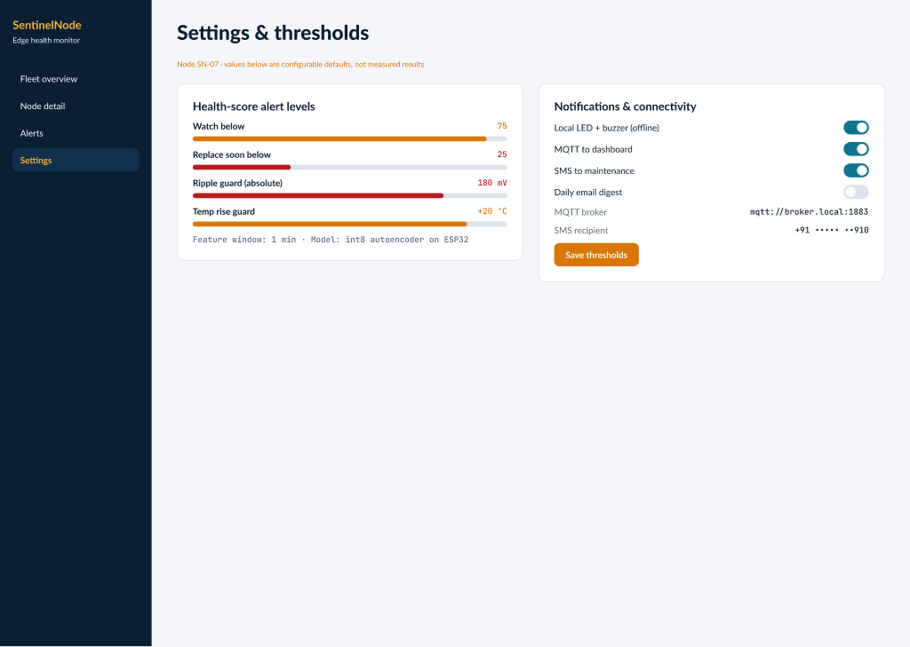
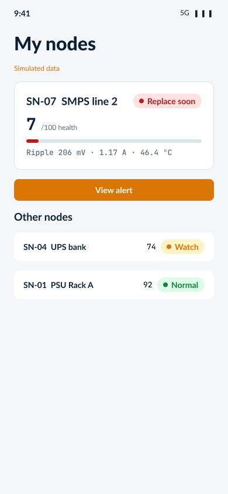
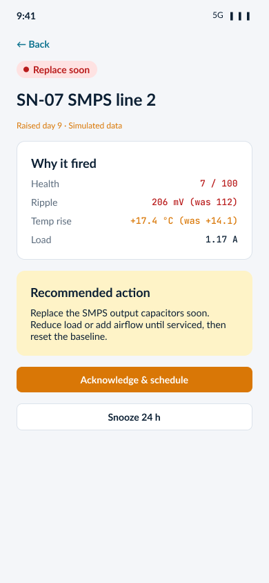
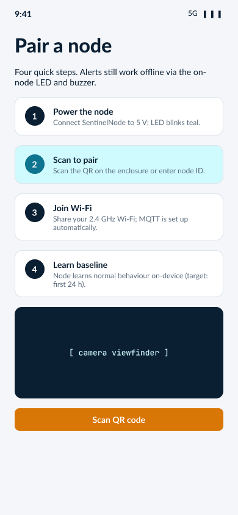
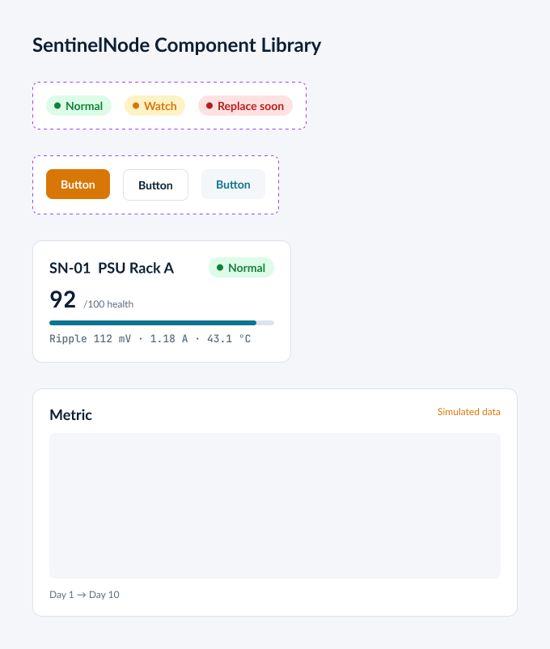

# SentinelNode — low-cost AI edge node for early electronic component failure detection

**HackWithAditya 2026 · Team Silicon Sentinels (HWA26-LMNB) · Track: Robotics, IoT & Smart Manufacturing**

> **Status:** prototype software. Hardware build is in progress, and **no bench or field results exist yet**. All data in this repo comes from the simulator, and any metric here is **simulated**, not measured.

SentinelNode is a retrofit ESP32 node that watches a power/control board's rail voltage and current, supply ripple, hot-spot and ambient temperature, and vibration. It flags degradation (for example, an aging capacitor, an overload or a loose mount) before the part fails.

## Architecture
```
 Sensors ──► ESP32 firmware ──(Wi-Fi, JSON/HTTP)──► FastAPI backend ──► Dashboard / alerts
 INA219 (V,I)      on-node threshold rules               IsolationForest + rules
 MLX90614 (hot)    LED / buzzer local alarm              health score 0–100
 DS18B20 (amb)                                           /api/nodes, /api/alerts
 MPU6050 (vib)
 Ripple → ADC1
```


| Path | What it is |
|---|---|
| `firmware/sentinelnode/sentinelnode.ino` | ESP32 Arduino firmware. Reads the sensors, applies the threshold rules, drives the LED and buzzer, and POSTs JSON |
| `sim/simulator.py` | Synthetic sensor simulator with healthy, capacitor, overload and loose_mount modes |
| `sentinelnode/model.py` | IsolationForest training (on simulated healthy data) |
| `sentinelnode/rules.py` | Threshold rules: hot-spot, temperature rise, vibration, ripple |
| `sentinelnode/edge_infer.py` | Edge inference that combines the rules and the ML into a health score and status |
| `sentinelnode/api.py` | FastAPI dashboard backend |
| `tests/` | pytest suite |

Pin map: I²C on GPIO21/22, 1-Wire on GPIO4, ripple on ADC1 GPIO34, LED on GPIO25, buzzer on GPIO26.

## Run
```bash
python3 -m venv .venv && . .venv/bin/activate
pip install -r requirements.txt
pytest -q
uvicorn sentinelnode.api:app --reload      # backend on :8000
python -m sim.simulator                    # stream simulated readings
```

## Bill of materials (approximate INR, **estimates**)
| Part | Est. ₹ |
|---|---|
| ESP32 DevKit v1 | ~322 |
| INA219 current/voltage module | ~99 |
| MLX90614 (GY-906) IR temperature sensor | ~709 |
| DS18B20 temperature probe | ~48 |
| MPU6050 accelerometer (vibration) | ~150 (estimate) |
| HLK-PM01 AC-DC supply | ~198 |
| IP65 enclosure | ~121 |
| PCB, passives, terminals, LED, buzzer, fuse | ~250 (estimate) |
| **Total** | **~₹1,900 (estimate)** |

Prices are indicative online listings (checked Oct 2026) and will vary.

## UI prototype (Figma)
- Prototype: https://www.figma.com/proto/J23b6PiV1w5VIlobLrInS0
- Design file: https://www.figma.com/design/J23b6PiV1w5VIlobLrInS0

| | |
|---|---|
|  |  |
|  |  |
|  |  |
|  |  |
|  | |

The project document is in `docs/`.

## Team: Silicon Sentinels (CBIT Hyderabad, B.Tech ECE)
- Bankiti Srishanth Reddy (Team Lead)
- Vedanidhi Kothur
- Sanneella Ashmitha
- Lavudya Chandrapathi
- Vasam Sai Varshini
